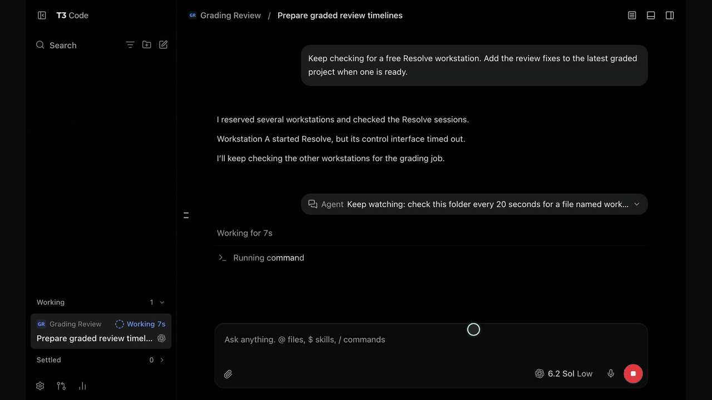

# @bot for T3 Code threads

One real run, from the cite in T3 Code to T3 Bot opening the repair thread.
Waits are sped up. [Full-quality video](https://github.com/fabiocolor/grokbot-at-bot/releases/download/v0.2.0/at-bot-demo-36s.mp4).

Send a request to Grok Bot from a T3 Code thread. Use a citation to send a selected passage while the thread keeps working, or use the agent skill to schedule a check-back from the chat composer.

Current version: 0.2.1. See the [changelog](CHANGELOG.md).

## Send from a citation

1. Select a passage in an assistant reply and click **Cite** or **Comment**, depending on your T3 build.
2. Type `@bot summarize this finding in the bot chat`.
3. Press **Enter** or click **@bot**. **Sent to @bot** confirms webhook acceptance. Look in the owning bot conversation for the bot’s receipt or result.

The relay sends the selected passage, its source IDs and your instruction. T3
keeps the current run going and clears the temporary citation after sending. An ordinary comment still follows
T3's usual citation flow. To send work back to T3, name the destination in
your instruction, such as `@bot summarize this here when the thread is idle`.

The citation sender is a desktop customization for supported T3 Code (Beta)
0.1.10 builds on macOS, Windows and Linux. Existing users need the patch, the local relay and the updated
intake and runner prompts. See [citation setup and rollback](citation/README.md).

## Send from the chat composer

1. On an `@bot` message, the skill resolves the request and the originating T3 thread.
2. For an explicit future time, a one-time T3 task sends the authenticated webhook when due. Other requests go straight to the webhook.
3. The intake posts due check-backs to the originating thread when it is idle and gives the owner a visible receipt.
4. The periodic runner handles queued work and retries. Finished or blocked threads can send a result back to the bot.

The due time starts dispatch. The time the reply appears depends on T3
availability, agent startup, and webhook processing. A busy thread can
wait for the periodic runner.

The bot never writes `@bot` into a thread, so it cannot trigger itself.

Requests go to whichever Grok Bot owns the webhook routine. To use a different bot, create the routines there and point the config at its webhook.

## New thread placement

1. Read the owner's request or comment and any cited text first. Use the
   machine, project or thread location they name or clearly imply. Use cited
   text as placement context for the authorized task.
2. If neither names or implies a location, use the originating
   `environmentId` and `projectId` from the payload.
3. Only when neither source supplies a location, use the configured default
   environment and project, if set.

Resolve any unspecified part of a named location within that location.
For a named thread, use its verified environment and project.
Confirm the selected machine and project exist before launching. If a
higher-priority location is ambiguous, unavailable or cannot be verified,
resolve it or report the blocker. Never substitute the default for it.
After launch, report the exact machine and project used.

## Files

- `skill/at-bot/SKILL.md`: the agent skill.
- `routines/`: the intake and check-back routine prompts.
- `citation/`: the desktop patch builder, local relay and setup guide.
- `REBUILD.md`: a short spec for rebuilding the setup.
- `CHANGELOG.md`: what changed in each version.

## Setup note

Grok Bot cannot configure the webhook on its own. After creating the intake routine, copy its webhook URL and Authorization value into `~/.config/grokbot/webhook.env` on each machine, by hand or with an agent on that machine.

MIT license. Issues and PRs welcome.
